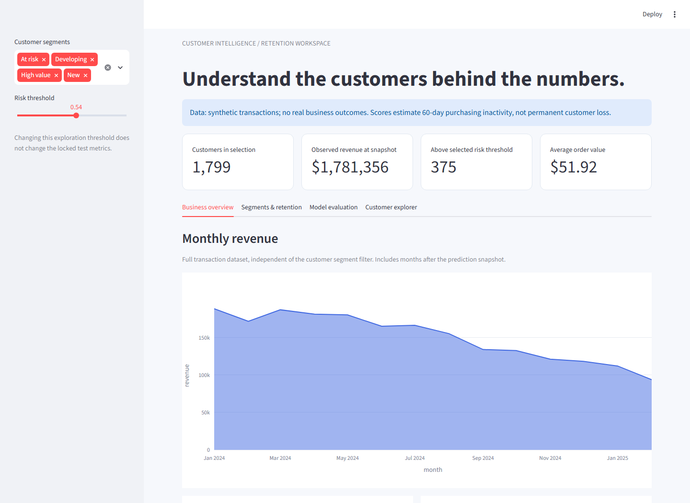
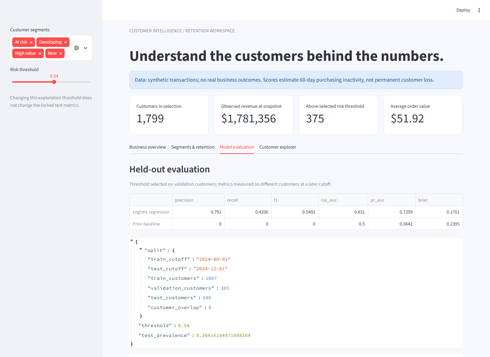

# Customer Intelligence

**From transactions to a defensible retention decision.**

[](https://github.com/Shreeya1807/Customer-Intelligence/actions/workflows/ci.yml)

A reproducible Python/SQL analytics project with RFM segmentation, behavioral clustering, cohort retention, churn-risk evaluation, and a filterable Streamlit dashboard. No credentials or paid service required.



<details>
<summary>View the held-out evaluation screen</summary>



</details>

## Run it

Python 3.12 recommended. From the repository root:

```bash
python -m venv .venv
# Windows: .venv\Scripts\activate
# macOS/Linux: source .venv/bin/activate
python -m pip install -r requirements.txt
python -m analytics.pipeline
streamlit run dashboard.py
```

Open http://localhost:8501. The initial pipeline generates seeded **synthetic** purchase histories for 1,800 customers. These are demonstrations, not customer data or evidence of business impact.

Alternatively: `docker build -t customer-intelligence .`, then `docker run --rm -p 127.0.0.1:8501:8501 customer-intelligence`.

## What the workflow does

1. Validate unique order IDs, timestamps, positive finite amounts, and required identifiers.
2. Build customer features with SQL aggregations over orders strictly before each prediction cutoff.
3. Fit scaled logistic regression and compare it against a prior-probability baseline.
4. Select a decision threshold using validation customers only; evaluate once on distinct customers at a later cutoff.
5. Fit K-means on log-transformed RFM features from training customers; separately assign transparent business-rule segments.
6. Export customer scores, monthly revenue, observed cohort retention, evaluation metrics, and a queryable SQLite warehouse.

The browser dashboard supports segment filtering, risk-threshold exploration, cohort charts, confusion-matrix review, and CSV export. Metric cards describe the selected customers; the full-dataset monthly revenue chart is explicitly labeled separately.

## Evaluation design

The outcome is **no purchases during the following 60 days**. This is an inactivity proxy, not confirmed cancellation or permanent churn.

| Partition | Feature cutoff | Customer buckets |
| --- | --- | --- |
| Train | 2024-09-01 | Stable hash buckets 0–5 |
| Validation | 2024-09-01 | Buckets 6–7 |
| Test | 2024-12-01 | Buckets 8–9 |

Training and test customers do not overlap. Features never include future orders. Every label requires a fully observed 60-day horizon. Scaling and clustering fit only training data; threshold selection does not inspect test outcomes. The dashboard labels scores for customers outside the holdout as exploration-only.

The seeded reference run measured ROC-AUC **0.831**, precision **0.791**, recall **0.421**, and F1 **0.549** on 346 held-out synthetic customers, with 36.4% inactivity prevalence. The baseline ROC-AUC was 0.500. The modest recall is visible rather than hidden: a retention strategy would need an explicit cost/recall tradeoff and evaluation on real, consented data. Reproduce current metrics in `artifacts/metrics.json`; dependency changes can affect numerical results.

## Bring your own transactions

```bash
python -m analytics.pipeline --source orders.csv --output artifacts
```

Required columns: `order_id`, `customer_id`, `ordered_at`, `amount`. Dates must cover both fixed cutoff windows through at least January 30, 2025. Normalize timezones and net/refund transactions before import; amounts must be positive. For a different period, deliberately change the cutoff configuration in the pipeline and re-run all leakage tests. Input data is processed locally and not committed.

## Tests and delivery

```bash
python -m analytics.pipeline
python -m pytest -q
```

Tests exercise feature-window boundaries, exclusion of future purchases, incomplete outcome windows, duplicate/null/non-finite inputs, deterministic generation, disjoint customer splits, exports, and dashboard rendering. CI runs these checks, uploads evaluation artifacts, and builds and health-checks the container.

## Power BI interoperability

A native three-page [Power BI project](powerbi/CustomerIntelligence/CustomerIntelligence.pbip) is included, with an embedded synthetic snapshot, DAX measures, overview cards, revenue/segment charts, a segment slicer, a cohort matrix, and model/customer tables. Regenerate it with `python -m analytics.powerbi` after running the pipeline. Its 21 metadata files were validated against Microsoft's official schemas; the model's embedded data is checked by tests. **Desktop rendering and refresh are not yet verified.** See [Power BI setup](powerbi/README.md). The Streamlit dashboard is browser-tested.

## Design limits

- Synthetic histories are intentionally reproducible and simplified. Results do not establish generalization, causal retention lift, revenue gains, or production accuracy.
- The business-rule segments and K-means cluster IDs are distinct concepts. Cluster numbers have no ordinal meaning.
- Scores on training/validation customers are exploratory; only the held-out metrics are evaluation evidence.
- No automated customer outreach, personal identifiers, billing, or external services are included.
- Large datasets need incremental SQL ingestion and a database engine sized for the workload; this project is a local portfolio pipeline.

## Project map

`analytics/data.py` — generation, validation, point-in-time SQL features  
`analytics/pipeline.py` — training, threshold selection, holdout evaluation, exports  
`dashboard.py` — interactive exploration and metric disclosure  
`tests/` — leakage, data quality, reproducibility, dashboard checks  
`powerbi/` — import instructions and reusable DAX measures

## Container releases

A `v*` tag or manual release reruns the full CI workflow before publishing a commit-addressed image to GitHub Container Registry with provenance and a software bill of materials. No image is published from a failed verification run. Hosting still requires a compatible runtime and persistent storage where applicable; publishing an image is not a cloud deployment.
